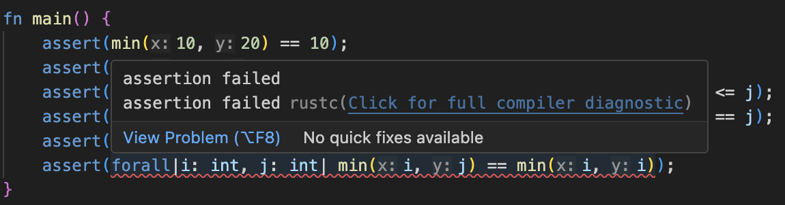


# VS Code で始める {#getting-started-with-vs-code}

このページでは、[verus-analyzer](https://github.com/verus-lang/verus-analyzer) 拡張機能を使って、VS Code で Verus を使えるようにします。なお、verus-analyzer は**きわめて実験的**なものです。

## 1. Rust のクレートを作る
{: id="1-create-a-rust-crate"}

まだであれば、[cargo](https://doc.rust-lang.org/cargo/getting-started/installation.html) をインストールします。
作業用のディレクトリを用意して、次を実行します。

```
cargo init verus_test
```

すると、次のファイルが作られます。

 * `verus_test/Cargo.toml`
 * `verus_test/src/main.rs`

## 2. VS Code から verus-analyzer をインストールする
{: id="2-install-verus-analyzer-via-vs-code"}

VS Code を開き、VS Code のマーケットプレイスから verus-analyzer をインストールします。

## 3. ワークスペースを VS Code で開く
{: id="3-open-your-workspace-in-vs-code"}

`File > Open Folder` を選び、`verus_test` ディレクトリを選択します。

## 4. rust-analyzer を無効にする
{: id="4-disable-rust-analyzer"}

rust-analyzer をインストールしている場合は、無効にしておくのがよいでしょう。verus-analyzer と役割が重複しますし、（適切に設定していないと）見たくもない余計なエラーが出るからです。

rust-analyzer を無効にするには、拡張機能のパネルを開いて rust-analyzer を探し、歯車のアイコンをクリックして、**"Disable (Workspace)"** を選びます。（こうすると、現在のワークスペースでだけ rust-analyzer が無効になります。）
続いて、表示される青い **"Restart Extensions"** ボタンをクリックします。

## 5. Verus が動いていることを確かめる
{: id="5-test-that-verus-is-working"}

`verus_test` プロジェクトの中で、`src/main.rs` ファイルを開きます。次の内容を貼り付けます。

```rust
use vstd::prelude::*;

verus! {

spec fn min(x: int, y: int) -> int {
    if x <= y {
        x
    } else {
        y
    }
}

fn main() {
    assert(min(10, 20) == 10);
    assert(min(-10, -20) == -20);
    assert(forall|i: int, j: int| min(i, j) <= i && min(i, j) <= j);
    assert(forall|i: int, j: int| min(i, j) == i || min(i, j) == j);
    assert(forall|i: int, j: int| min(i, j) == min(j, i));
    assert(forall|i: int, j: int| min(i, j) == min(i, i));
}

} // verus!
```

ファイルを保存すると、verus-analyzer が動き出します。

このプログラムには、Verus が検出するはずの誤りが 1 つあります。
すべてが正しく動いていれば、最後の `assert` の行に Verus からのエラーが表示されるはずです。



"Click for full compiler diagnostic" というリンクをクリックすると、次のようなエラーが表示されるはずです。

```
error: assertion failed
  --> verus_test/src/main.rs:19:12
   |
19 |     assert(forall|i: int, j: int| min(i, j) == min(i, i));
   |            ^^^^^^^^^^^^^^^^^^^^^^^^^^^^^^^^^^^^^^^^^^^^^ assertion failed
```

この行を削除してください。すると今度は、ファイルの検証に成功したと Verus が報告するはずです。

## 6. verus-analyzer 拡張機能についてさらに学ぶ
{: id="6-learn-more-about-the-verus-analyzer-extension"}

verus-analyzer の詳しい情報や使い方のこつは、[verus-analyzer の README](https://github.com/verus-lang/verus-analyzer) を参照してください。

## 7. Verus についてさらに学ぶ
{: id="7-learn-more-about-verus"}

[チュートリアルに進みましょう](./verus_macro_intro.html)。まずは、上の例に出てきた `verus!` マクロの説明から始まります。

