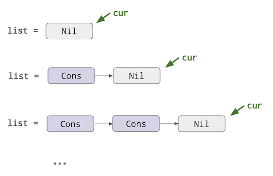
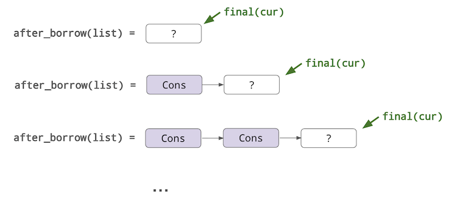


# 可変参照 {#mutable-references}

可変参照の単純な使い方、つまり、1 つの関数の中で完結し、ループが関わらない使い方であれば、Verus の証明の方策は、たいてい可変参照を正確に、さほど苦労せずに追跡できます。
たとえば、次のとおりです。

```rust
fn example_basic() {
    let mut a = 0;
    let a_ref = &mut a;

    *a_ref = 5;

    assert(a == 5);
}
```

あるいは、次のとおりです。

```rust
fn example_pattern() {
    let mut a = Some(0);

    match &mut a {
        Some(inner_ref) => {
            // Obtain a reference to the contents of the Option
            *inner_ref = 20;
        }
        None => { }
    }

    assert(a === Some(20));
}
```

もっと複雑な例では、可変参照についての仕様を書かなければならないことがよくあります。
この節の残りでは、その方法を見ていきます。

## 関数の仕様 {#function-specifications}

可変参照を扱う最も一般的な方法の 1 つは、可変参照を引数に取る関数を用意することです。この場合、たいていは、「入力」の値（つまり、関数の開始時点で参照の先にある値）と「出力」の値（つまり、関数の終了時点で参照の先にある値）を関係づける仕様が必要になります。

```rust
fn add_1(x: &mut u8)
    requires *x < 255
    ensures *final(x) == *old(x) + 1
{
    *x += 1;
}
```

事前条件では、`*x` を使って、関数の開始時点で可変参照の先にある値を指しています。（この例では、加算演算子によるオーバーフローを防ぐために事前条件を使っています。）
事後条件では、入力の値（`old` を使います）と出力の値（`final` を使います）の両方を指しています。

> **余談: 事後条件で単に `*x` と書けないのでしょうか**
>
> 厳密に言うと、仕様の中の `*x` は常に、関数の*開始時点*で `x` が指している値を指します。
> `x` は入力引数なので、ほかの入力引数とまったく同じように、常に呼び出し時点の値に基づいて評価されるからです。
>
> しかし、慣れていない人にはこれが紛らわしいかもしれない、とも私たちは考えています。直感的には、事後条件の中で使われた `*x` は、更新後の値を指すと期待するかもしれません。
> そこで Verus は現在、開発者に `old(x)` と書いて曖昧さを無くすよう求めています。
>
> *歴史的には*、Verus はかつて事後条件での `*x` を許しており、そこでは更新後の値を指していました。しかし、この特別扱いは、Verus があとで採用した形式的な理論と両立しないことが分かったため、この機能は取り除かれました。

## 可変借用を返す {#returning-mutable-borrows}

もっと複雑な例として、可変参照を*返す*関数を取り上げましょう。
具体的には、`&mut (A, B)` を入力に取り、最初のフィールドへの可変参照 `&mut A` を返す関数を書いてみます。

```rust
fn get_mut_fst<A, B>(pair: &mut (A, B)) -> (ret: &mut A)
    requires ???
    ensures ???
{
    &mut pair.0
}

fn get_mut_fst_test() {
    let mut p = (10, 20);

    let r = get_mut_fst(&mut p);
    *r = 100;

    assert(p === (100, 20));
}
```

`get_mut_fst` の仕様をどう書けばよいか、少し考えてみてください。
これがやや難しいのは、`pair.0` の「最終的な」値が、関数の終了時点では具体的に分かっていないからです。この値は、返された可変参照 `ret` を操作できる呼び出し側によって変更されうるのです。
したがって、`pair` の最終的な値は、`ret` の最終的な値*を使って表す*必要があります。

Verus は `get_mut_fst` に対する次の仕様を受け付け、これを使って `get_mut_fst_test` を証明できます。

```rust
fn get_mut_fst<A, B>(pair: &mut (A, B)) -> (ret: &mut A)
    ensures
        *ret == old(pair).0,
        *final(pair) == (*final(ret), old(pair).1),
{
    &mut pair.0
}
```

`final(ret)` と `final(pair)` は、この関数の終了時点では具体的に分かりません（呼び出し側が `ret` を使い終えるまで、たとえば `get_mut_fst_test` の `*r = 100;` の行の後になるまで分かりません）。それでも、`final(ret)` と `final(pair)` の間のこの*関係*は分かっている、という点に注意してください。

`get_mut_fst_test` を証明するために、Verus はおおよそ次のように推論します。

```rust
fn get_mut_fst_test() {
    let mut pair = (10, 20);

    let r = get_mut_fst(&mut pair);
    //                  ^^^^^^^^^ refer to this value as `pair_ref`, of type `&mut (u64, u64)`
    //
    // From the postcondition of `get_mut_fst` we know that:
    //    *final(pair_ref) == (*final(r), 20)

    *r = 100;

    // Now we know that:
    //    *final(r) == 100
    // So:
    //    *final(pair_ref) == (100, 20)

    // Finally, since `pair_ref` was borrowed from `pair`, and the borrow has expired
    // at this point, we can deduce that:
    assert(pair == (100, 20));
}
```

## そのほかの例 {#more-examples}

可変参照を返す関数の例を、さらにいくつか示します。

**複数の可変参照を返す**

```rust
fn pair_split<T, U>(pair: &mut (T, U)) -> ((fst, snd): (&mut T, &mut U))
    requires
    ensures
        *fst == old(pair).0,
        *snd == old(pair).1,
        *final(pair) == (*final(fst), *final(snd))
{
    (&mut pair.0, &mut pair.1)
}

fn pair_split_test() {
    let mut pair = (1, 2);
    let (fst, snd) = pair_split(&mut pair);
    *fst = 10;
    *snd = 20;

    assert(pair === (10, 20));
}
```

**ベクタの要素を添字で指す**

```rust
fn vec_index_mut<T>(vec: &mut Vec<T>, i: usize) -> (element: &mut T)
    requires
        0 <= i < vec.len(),
    ensures
        *element == old(vec)@[i as int],
        final(vec)@ == old(vec)@.update(i as int, *final(element)),
{
    &mut vec[i]
}

fn vec_index_mut_test() {
    let mut v = vec![10, 20];
    *vec_index_mut(&mut v, 1) = 200;

    assert(v.len() == 2);
    assert(v[0] == 10);
    assert(v[1] == 200);
}
```

## 借用中のデータについての仕様 {#specs-about-borrowed-data}

変数が借用されている間に、spec コードの中でその変数にアクセスしようとするとどうなるのか、気になるかもしれません。

```rust
fn main() {
    let mut x = 0;
    let x_ref = &mut x;

    assert(x == 0); // ??? Will this pass?

    *x_ref = 20; 
}
```

実は、Verus はこれを禁止しており、借用エラーと同じように扱います。

```
error[E0502]: cannot borrow `(Verus spec x)` as immutable because it is also borrowed as mutable
  --> simple_test.rs:9:12
   |
 7 |     let x_ref = &mut x;
   |                 ------ mutable borrow occurs here
 8 |
 9 |     assert(x == 0); // ??? Will this pass?
   |            ^ immutable borrow occurs here
10 |
11 |     *x_ref = 20;
   |     ----------- mutable borrow later used here

error: aborting due to 1 previous error
```

このエラーメッセージの言い回しは、少し分かりにくいかもしれません。言おうとしているのは、`x` は現在、可変として借用されているので、`spec` コードの中であっても `x` を読むことはできない、ということです。
（エラーメッセージがこの言い回しになっている理由は、Verus がこれを検査する方法に関係しています。Verus は、`Verus spec x` という名前の人工的な変数を借用検査のパスに文字どおり注入し、それが `x` と同じライフタイムの間借用されるように強制するのです。）

しかし、`x` の値を読む方法は、それでも**あります**。Verus の組み込み演算子 `after_borrow` を使う方法です。この演算子を使うと、ローカル変数をいつでも読めますが、得られるのは常に、まだ残っている借用が期限切れになったあとで `x` が*持つことになる*値です。これを扱うのは少し直感に反することが多く、主に高度な場面で役立ちます。

たとえば、`after_borrow(x)` は、借用が期限切れになる前でも読めます。

```rust
fn main() {
    let mut x = 0;
    let x_ref = &mut x;

    assert(after_borrow(x) == after_borrow(x));

    *x_ref = 20; 
}
```

式 `after_borrow(x)` は、`*final(x_ref)` とよく似ていて、この時点では具体的には分かりません。

```rust
fn main() {
    let mut x = 0;
    let x_ref = &mut x;

    assert(after_borrow(x) == 20); // FAILS

    *x_ref = 20; 

    assert(after_borrow(x) == 20); // ok
}
```

しかし、上の仕様のときとよく似た形で、具体的でない値どうしの関係を記述することはできます。

```rust
fn main() {
    let mut x = 0;
    let x_ref = &mut x;

    assert(after_borrow(x) == *final(x_ref));

    *x_ref = 20; 
}
```

それでは、この知識をどう応用するかを見ていきましょう。

## ループを扱う {#working-with-loops}

`after_borrow` を使ってローカル変数を可変参照に関係づけることは、ループ不変条件を書く必要があるときに、とくに役立ちます。

まず、おもちゃのような例を見てみましょう。

次の（自明な）ループを考えます。

```rust
fn loop_test() -> (r: u64)
    ensures r == 30,
{
    let mut a = 0;
    let a_ref = &mut a;

    loop
        decreases 0nat
    {
        *a_ref = 30;
        return a;
    }
}
```

これは、ループがあるせいで失敗します。ループがあると、Verus は `a` と `a_ref` の間の関係を見失ってしまうのです。必要なのは、関連する事実をループ不変条件に書いて与えることだけです。

```rust
fn loop_test() -> (r: u64)
    ensures r == 30,
{
    let mut a = 0;
    let a_ref = &mut a;

    loop
        invariant after_borrow(a) == *final(a_ref),
        decreases 0nat
    {
        *a_ref = 30;
        return a;
    }
}
```

## `has_resolved` 演算子: 可変参照が「済んだ」とき {#the-has_resolved-operator-when-mutable-references-are-done}

可変借用が「完了した」ことを、Verus はどうやって知るのでしょうか。
これまで見てきたとおり、可変借用を作ると、その可変借用の「最終的な」値についてすぐに推論できるようになりますが、その値は、プログラムのあとの時点になるまで具体的にはなりません。その時点とは、正確にはどこなのでしょうか。

どの可変参照についても、その参照が二度と変更されなくなるプログラム上の時点に達したとき、その参照は「解決済み（resolved）」であると言います。

```rust
fn main() {
    let mut x = 0;
    let x_ref = &mut x;
    *x_ref = 20; 
    *x_ref = 30;

    // `x_ref` is resolved at this point

    assert(x == 30);
}
```

Verus は、これについて直接推論するための `has_resolved` 演算子を提供しています。

```rust
fn main() {
    let mut x = 0;
    let x_ref = &mut x;

    assert(has_resolved(x_ref)); // fails

    *x_ref = 20; 

    assert(has_resolved(x_ref)); // fails

    *x_ref = 30;

    assert(has_resolved(x_ref)); // ok

    assert(x == 30);
}
```

`x_ref` がどこで解決済みになるかを判定するために、Verus は、`*x_ref` に代入するプログラム上のすべての時点を考慮する到達可能性解析を使います。
たいていは、これが裏側で滞りなく働き、可変参照からのデータが借用元の場所へ確実に戻るようにしてくれます。もっと高度な場面（とくに、`(&mut T, &mut T)` や `Vec<&mut T>` のような、可変参照のコンテナを扱う場合）では、この概念を知っておくと役に立ちます。

`has_resolved` 演算子を導入したので、上のプログラムを完全に分解して、Verus が `x == 30` というアサーションをどのように確かめるのかを理解できます。
まず、`has_resolved(x_ref) ==> *x_ref == *final(x_ref)` であること、つまり「`x_ref` がこの時点より後で二度と変更されないなら、その現在の値は最終的な値と等しいはずだ」ということを知っておく必要があります。

これを踏まえて、Verus は次のように推論します。

```rust
fn main() {
    let mut x = 0;
    let x_ref = &mut x;

    // When taking a mutable reference, we get:
    // after_borrow(x) == *final(x_ref)

    *x_ref = 20; 
    *x_ref = 30;

    // Here we have:
    //     has_resolved(x_ref)
    // so:
    //     *x_ref == *final(x_ref)
    //
    // And of course, at this point, we have:
    //     *x_ref == 30

    // Putting all these together we get `after_borrow(x) == 30`

    // At this point, the borrow is expired, and we can refer directly to `x`:
    assert(x == 30);
}
```

`has_resolved` 演算子は、可変参照に限らず、どんな変数にも適用できます。
これは、可変参照を含む（または含むかもしれない）コンテナで役立ちます。
タプル、構造体、列挙型に適用した場合、`has_resolved` は、*入れ子になった*可変参照がすべて解決済みであることを意味します。こうした性質は、次のような公理によって与えられます。

 * `has_resolved::<(T, U)>((t, u)) ==> has_resolved::<T>(t) && has_resolved::<U>(u)`
 * `has_resolved::<Vec<T>>(vec) ==> has_resolved::<T>(vec[i])`（[`axiom_vec_has_resolved`](https://verus-lang.github.io/verus/verusdoc/vstd/std_specs/vec/fn.axiom_vec_has_resolved.html)）

可変参照のコンテナの使い方について詳しくは、[あとのこの章](./container_bst_mut_refs.html)を参照してください。

## 高度な応用: リストを組み立てる {#advanced-application-building-a-list}

最後に、もっと複雑な例に取り組んで、可変参照を「最終的な値」どうしの関係で考える、という発想をさらに深く身につけましょう。

具体的には、可変参照を使って cons リストを「根から下へ向かって」組み立てる方法と、それを検証する方法を見ていきます。
このコードは、`cur` がリストの末尾にある `Nil` の項目を指している、という不変条件を保ち、各反復でその `Nil` を `Cons(0, Nil)` に置き換えます。したがって、各反復でリストは下側から 1 要素ずつ伸び、最後には `list` が長さ `len` のリストになります。

```rust
enum List {
    Cons(u64, Box<List>),
    Nil,
}

fn build_zero_list(len: u64) -> List {
    let mut list = List::Nil;
    let mut cur = &mut list;

    let mut i = 0;
    while i < len {
        *cur = List::Cons(0, Box::new(List::Nil));

        match cur {
            List::Cons(_, b) => {
                // Replace `cur` with a reference to the newly-created List::Nil,
                // the child of the previous `cur`.
                cur = &mut *b;
            }
            _ => { /* unreachable */ }
        }

        i += 1;
    }

    return list;
}
```

まず、リスト（`list`）を `Nil` に等しい状態から始め、それへの参照（`cur`）を取ります。
各ステップでは、`cur` が指す値を `Cons` ノードに置き換え、そのあと参照を子のほうへ下ろします。
このプログラムでは、cur ポインタを通じて書き込むこと（`*cur = ...`）*と*、ポインタそのものを上書きすること（`cur = ...`）の両方を行っている点に注意してください。
たとえば次の図は、開始時点と、最初の 2 回の反復を経たときのプログラムの状態を描いたものです。

<center>

</center>

それでは、このプログラムを検証しましょう。具体的には、最後に得られるリストの長さが、入力引数 `len` と等しいことを証明します。

したがって、主な目標は、最初の借用（`cur = &mut list`）が期限切れになったあとの `list` の値について、何かを証明することです。
これを証明する鍵は、プログラムがループを進むにつれて、この値の形がだんだん「具体的」になっていくことに気づくことです。

 * ループの開始時点では、`cur` は `list` から借用されています。この時点では、`*cur` を好きなものに設定する自由があるので、`list` の最終的な値については何も分かりません。
 * 1 回の反復のあとでは、その場所に `Cons` ノードを代入し、`cur` 参照をその子への参照に置き換えています。
   この `Cons` ノードは、もう「確定」しています。そのノードへの参照はもう持っていませんが、子を好きなものに設定する自由はまだあります。
 * 以下同様です。

<center>

</center>

最後の反復が終わり、`cur` が完全に期限切れになって初めて、最後のノードが「nil」であることが分かり、リストは完全に具体的になります。

さて、この図から、`final(cur)` を `final(list)` に関係づける不変条件を書けば、プログラムが正しいことを証明できそうだと分かります。
具体的には、`final(list)` は常に、`final(cur)` の上に `i` 個の「Cons」ノードを付け加えたものに等しい、と言えます。

```rust
enum List {
    Cons(u64, Box<List>),
    Nil,
}

spec fn append_zeros(n: nat, list: List) -> List
    decreases n
{
    if n == 0 {
        list
    } else {
        append_zeros((n-1) as nat, List::Cons(0, Box::new(list)))
    }
}

fn build_zero_list(len: u64) -> (list: List)
    ensures list == append_zeros(len as nat, List::Nil),
{
    let mut list = List::Nil;
    let mut cur = &mut list;

    let mut i = 0;
    while i < len
        invariant
            0 <= i <= len,
            *cur == List::Nil,
            after_borrow(list) == append_zeros(i as nat, *final(cur)),
        decreases len - i
    {
        *cur = List::Cons(0, Box::new(List::Nil));

        match cur {
            List::Cons(_, b) => {
                // Replace `cur` with a reference to the newly-created List::Nil,
                // the child of the previous `cur`.
                cur = &mut *b;
            }
            _ => { /* clearly unreachable */ }
        }

        i += 1;
    }

    return list;
}
```

